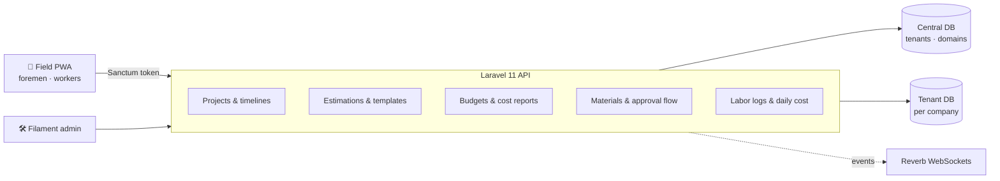

<div align="center">

# 🏗️ Construction SaaS · Backend API

### Multi-tenant Laravel API for estimations, budgets, materials and field labor


**Part of the Construction SaaS suite:**
**Backend API** (this repo) · [Admin panel](https://github.com/shacrawi92/construction-admin) · [Field PWA](https://github.com/shacrawi92/construction-pwa)

</div>

---

## 🧭 Overview

This repository holds the domain core of a construction management SaaS. Each construction company is a tenant with its own database. Inside it, estimators price work, managers approve budgets, foremen log labor and request materials, and everyone gets notified in real time.



## ✨ Capabilities

| Domain | Highlights |
|---|---|
| 📐 **Estimations** | Line-item estimations by work type, approval, save-as-template, **PDF and Excel export** |
| 💰 **Finances** | Per-project budgets, budget transactions, cost reports (`BudgetService`) |
| 📦 **Inventory** | Material catalog, multi-item material requests, approve / reject flow with notifications |
| 👷 **Personnel** | Labor logs per foreman, daily labor cost series |
| 📅 **Projects** | Project CRUD and timeline milestones |
| 🔔 **Notifications** | Paginated inbox, mark-as-read, broadcast over Reverb |
| 🌍 **Localization** | Per-user locale endpoint (English, Amharic, Somali on the client) |

## 📁 Structure

```
app/
├── Domains/            # Business logic, one service per domain
│   ├── Finances/       BudgetService
│   ├── Inventory/      RequestApprovalService
│   ├── Personnel/      LaborLogService
│   └── Projects/       EstimationService, ProjectService
├── Http/               # Controllers & requests
├── Models/             # 15 Eloquent models
└── Notifications/
database/migrations/
├── central/            # tenants, domains
└── tenant/             # projects, estimations, budgets, materials, personnel…
routes/
├── api.php
└── channels.php
```

## 🔌 API at a glance

| Area | Endpoints |
|---|---|
| Auth | `POST /login` · `POST /logout` · `GET /me` · `PATCH /locale` |
| Projects | `apiResource /projects` · `/projects/{id}/timelines` · `/budgets` · `/cost-report` |
| Estimations | `GET/POST /estimations` · `POST /items` · `POST /approve` · `POST /save-as-template` · `GET /export/pdf` · `GET /export/excel` |
| Materials | `GET /materials` · `POST /material-requests` · `POST /material-requests/{id}/approve` · `/reject` |
| Labor | `GET/POST /labor-logs` · `DELETE /labor-logs/{id}` · `GET /labor-logs/daily-cost` |

See [`routes/api.php`](routes/api.php) for the full list.

## 🚀 Getting started

This repo contains the application layer (`app/`, `database/`, `routes/`). Drop it into a fresh Laravel 11 install:

```bash
composer create-project laravel/laravel:^11.0 construction-api
cd construction-api
# copy app/, database/, routes/ and composer.json from this repo over the skeleton
composer install
cp .env.example .env && php artisan key:generate
php artisan migrate --path=database/migrations/central
php artisan tenants:migrate
php artisan serve
```

**Key packages:** `stancl/tenancy`, `laravel/sanctum`, `laravel/reverb`, `spatie/laravel-permission`, `barryvdh/laravel-dompdf`, `maatwebsite/excel`, `intervention/image`.

## 📄 License

Proprietary. All rights reserved.

<div align="center">

Built by **[@shacrawi92](https://github.com/shacrawi92)**

</div>
